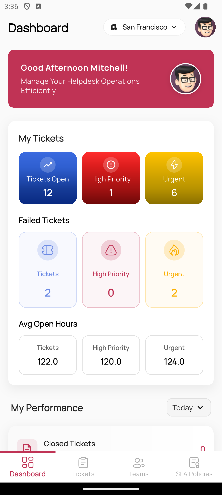
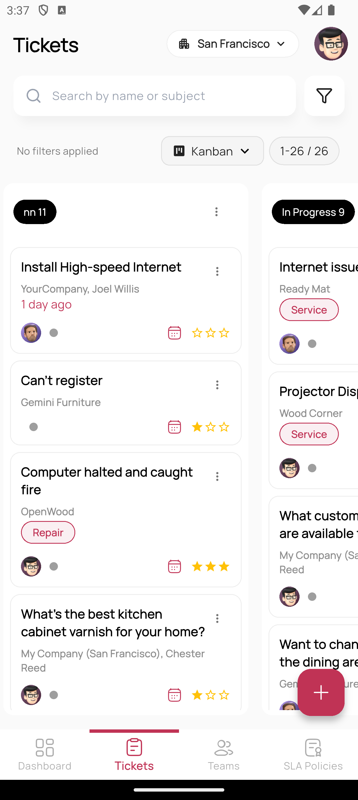
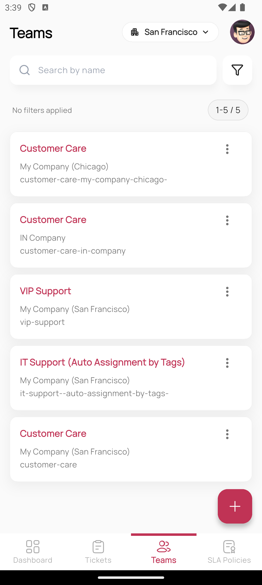
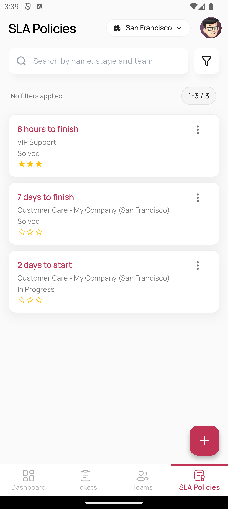
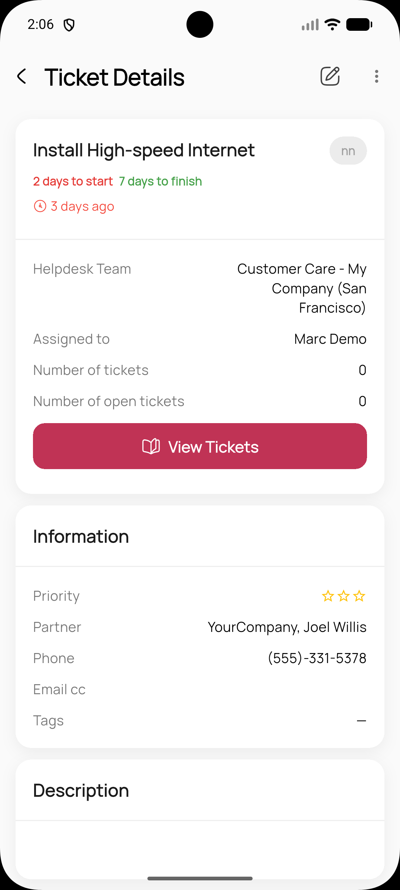
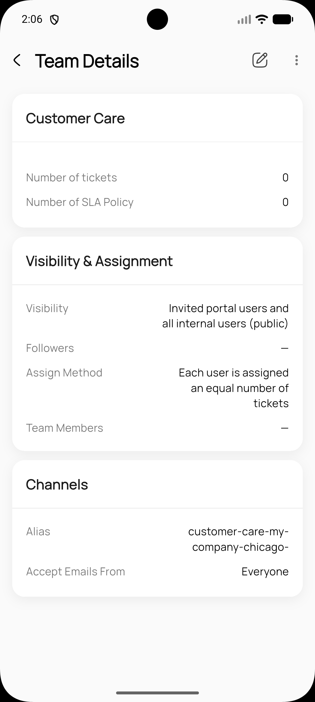
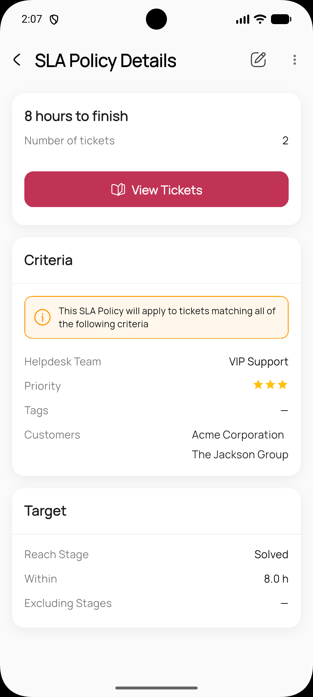

# Mobo Helpdesk


**Mobo Helpdesk** is a powerful, offline-first mobile application built with Flutter that brings
Odoo Helpdesk capabilities directly to your pocket. Designed for support agents, team leads, and
field technicians, it enables real-time ticket management, SLA tracking, customer ratings, team
performance insights, and seamless offline synchronization.

## Key Features

### Ticket Management
- **Full Ticket Lifecycle** — Create, view, edit, and close tickets on the go
- **Smart Views** — My Tickets, Unassigned, Followed, SLA Success/Failed, High Priority, Urgent
- **Rich Ticket Details** — Partner info, SLA deadlines, stages, activities, and priority levels

### SLA & Performance Monitoring
- **Live SLA Tracking** — Monitor success rate, failed tickets, and deadlines
- **Team Performance** — View closed tickets, success rate, and average customer ratings
- **Daily Targets** — Set and track personal/team goals for closed tickets, SLA success, and ratings

### Customer Ratings & Feedback
- **Star Ratings** — Collect and view customer satisfaction ratings
- **Feedback Management** — See comments and respond to dissatisfied customers
- **Rating Analytics** — Filter by period (Today, Last 7 days, Daily Target)

### Team & Collaboration
- **Team Overview** — Support statistics per helpdesk team
- **Assignment Tracking** — Monitor open, unassigned, and urgent tickets per team
- **Multi-Company Support** — Switch between companies seamlessly

### Beautiful & Accessible UI
- **Modern Design** — Clean cards, smooth animations, and HugeIcons
- **Dark Mode Support** — Comfortable usage in any lighting
- **Motion Reduction** — Respects user accessibility preferences

## Screenshots

<div>
  
  
  
  
  
  
  
</div>

## Technology Stack

- **Frontend**: Flutter (Dart)
- **State Management**: BLoC + Provider
- **Backend Integration**: Odoo JSON-RPC
- **UI Components**: HugeIcons, Lottie, Shimmer, dropdown_button2
- **Connectivity**: connectivity_plus
- **Authentication**: Odoo Session Management + Biometrics 
- **Navigation**: Smooth slide transitions with `PageRouteBuilder`

## Getting Started

### Prerequisites

- Flutter SDK (Latest Stable)
- Odoo Instance - Enterprise only (v14 or higher recommended)
- Android Studio or VS Code

### Installation

1. **Clone the repository**
   ```bash
   git clone https://github.com/mobo-suite/mobo_helpdesk.git
   cd mobo_helpdesk
   ```

2. **Install dependencies**
   ```bash
   flutter pub get
   ```

3. **Run the application**
   ```bash
   flutter run
   ```

## Configuration

1. **Server Connection**: Upon first launch, enter your Odoo server URL and database name.
2. **Authentication**: Log in using your Odoo credentials. Biometric login can be enabled from
   settings.

## License

See the [LICENSE](LICENSE) file for the main license
and [THIRD_PARTY_LICENSES.md](THIRD_PARTY_LICENSES.md) for details on included dependencies and
their respective licenses.

## Maintainers

**Team Mobo at Cybrosys Technologies**

- Email: [cybroplay@gmail.com](mailto:cybroplay@gmail.com)
- Website: [cybrosys.com](https://www.cybrosys.com)
